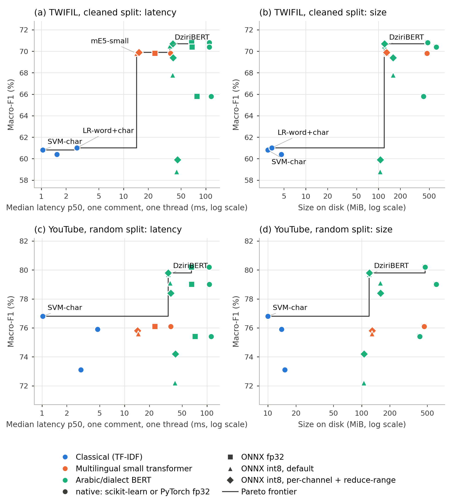

# Accuracy Is Not Enough: A Deployment-Aware Benchmark of Algerian Dialect Sentiment Classifiers for CPU Inference

Code, data splits and raw results for the paper *Accuracy Is Not Enough: A Deployment-Aware Benchmark of Algerian Dialect Sentiment Classifiers for CPU Inference*.

The study measures classification quality and deployment cost **on the same artefacts**. Three TF-IDF classifiers and four
pre-trained transformers (DziriBERT, MARBERTv2, CAMeLBERT-DA, multilingual-e5-small) are trained on three public Algerian
datasets after an audit that removes empty, contradictory, duplicated and leaked items, and on a second YouTube split
grouped by video. The transformers are exported to ONNX at fp32 and int8 precision, the int8 export is evaluated over three
training seeds, and every artefact is benchmarked in a fresh process on one CPU thread, on two processors, for size on
disk, peak memory, cold start and latency, together with its macro-F1 on the full test set.

## Main results

One thread of an Intel Xeon CPU @ 2.20GHz (AVX2, no AVX-512, VNNI or AMX), five identical passes per artefact, medians;
single-comment latency; the benchmarked artefact is the seed-13 model. All tables are in [`results/`](results/).

| Dataset | Model | Format | Macro-F1 (%) | Size (MiB) | Peak RSS, serving (MiB) | p50 (ms) | p95 (ms) |
|---|---|---|---:|---:|---:|---:|---:|
| TWIFIL (cleaned) | SVM-char | scikit-learn | 60.8 | 3.0 | 204 | 1.04 | 1.31 |
| TWIFIL (cleaned) | LR-word+char | scikit-learn | 61.0 | 3.4 | 206 | 2.71 | 3.42 |
| TWIFIL (cleaned) | DziriBERT | PyTorch fp32 | 70.8 | 475.9 | 909 | 110.7 | 209.5 |
| TWIFIL (cleaned) | DziriBERT | ONNX int8 (per-channel + RR) | 70.7 | 121.0 | 247 | 39.7 | 86.9 |
| TWIFIL (cleaned) | mE5-small | ONNX int8 (per-channel + RR) | 69.9 | 129.3 | 473 | 15.4 | 34.6 |
| Algerian Dialect YouTube | SVM-char | scikit-learn | 76.8 | 10.0 | 261 | 1.02 | 1.63 |
| Algerian Dialect YouTube | LR-word+char | scikit-learn | 75.9 | 14.0 | 305 | 4.73 | 5.87 |
| Algerian Dialect YouTube | DziriBERT | PyTorch fp32 | 80.2 | 475.9 | 921 | 106.2 | 257.1 |
| Algerian Dialect YouTube | DziriBERT | ONNX int8 (per-channel + RR) | 79.8 | 121.0 | 253 | 34.0 | 121.7 |
| Algerian Dialect YouTube | mE5-small | ONNX int8 (per-channel + RR) | 75.8 | 129.3 | 474 | 14.4 | 46.9 |



## Repository layout

```
notebooks/
  01_data_preparation.ipynb       data download, cleaning, audit and splits (Colab, CPU)
  02_models_and_benchmark.ipynb   training (three seeds), quality, ONNX export, int8 quantisation, first CPU benchmark
  03_extended_experiments.ipynb   video-grouped YouTube split, int8 over three seeds, standardised CPU benchmark on two
                                  processors, TWIFIL score decomposition
data/
  splits/<dataset>/{train,dev,test}.csv     ids and labels of every split (all datasets)
  processed/<dataset>/{train,dev,test}.csv  cleaned text (TWIFIL cleaned and YouTube only)
  audit/                                    dataset statistics, audit counts, per-item removal log
results/
  notebook02/    tables written by notebook 02 (quality, bootstrap intervals, link-only tweets, first benchmark)
  notebook03/    tables written by notebook 03 (grouped split, int8 over seeds, standardised benchmark, decomposition);
                 *_amd_epyc: the same benchmark on an AMD EPYC 7B12
  raw/           per-pass benchmark files and prediction checks of both processors, int8 results of the extra seeds,
                 predictions and metrics of every training run of notebook 03
  provenance/    library versions, hardware, configuration and raw-file hashes of each notebook
  figures/       the two figures of the paper
scripts/
  make_figures.py    regenerates results/figures/ from results/notebook03/table_deployment_standard.csv
  paper_numbers.py   prints derived numbers quoted in the paper (grouped split, decomposition, int8 over seeds)
MANIFEST.sha256      SHA-256 checksum of every file
```

## Data

| Folder name | In the paper | Train / dev / test | Included here | Source and licence |
|---|---|---|---|---|
| `twifil_official` | TWIFIL, DziriBERT split | 6,369 / 708 / 2,360 | ids and labels | Moudjari et al. (LREC 2020), as distributed with DziriBERT (commit `8d6959c`); CC BY-NC-SA 4.0 |
| `twifil_clean` | TWIFIL, cleaned | 4,998 / 556 / 1,942 | ids, labels, cleaned text | derived from the above; CC BY-NC-SA 4.0 |
| `youtube` | Algerian Dialect YouTube, random split | 35,928 / 4,491 / 4,491 | ids, labels, five-level label, video id, cleaned text | Benmounah, Mendeley Data V2, doi:10.17632/zzwg3nnhsz.2; CC BY 4.0 |
| `youtube_grouped` | Algerian Dialect YouTube, grouped by video | 36,516 / 4,421 / 3,973 | ids, labels, five-level label, video id (text as in `youtube`) | as above |
| `narabizi` | NArabizi, 3 classes | 755 / 97 / 113 | ids and labels | Touileb and Barnes (Findings of ACL 2021), github.com/SamiaTouileb/Narabizi |
| `narabizi_4class` | NArabizi, 4 classes | 997 / 137 / 144 | ids and labels | as above |

Labels: `0` negative, `1` neutral, `2` positive (`3` mixed in `narabizi_4class`). The folder name `twifil_official` is kept
because the code uses it; the paper calls this split *the DziriBERT split*, since it was published by the DziriBERT authors
rather than with TWIFIL itself. The grouped YouTube split uses stratified group 10-fold partitioning on the five-level label
(scikit-learn 1.6.1, seed 42; one fold for testing and one for development); comments without a video link form groups of
their own. Texts that are not included here are rebuilt by notebook 01 from the original sources at pinned versions. See
[`data/README.md`](data/README.md) for the id schemes and columns, and [`DATA_LICENSES.md`](DATA_LICENSES.md) for the
licences.

**Link-only tweets.** 1,312 of the 9,437 tweets in the DziriBERT split (13.9%) contain no Arabic or Latin letter, emoji or
emoticon once links and mentions are removed (1,210 consist of links and mentions alone, 80 of punctuation or digits, 22 of
text in other scripts); 1,283 of them are labelled neutral. They are listed in
[`data/audit/removed_items.csv`](data/audit/removed_items.csv) together with every other item removed by the audit.

## Reproducing the results

1. **Data.** Open `notebooks/01_data_preparation.ipynb` in Google Colab (CPU runtime). Download the YouTube dataset from
   Mendeley Data (doi:10.17632/zzwg3nnhsz.2) into `MyDrive/alg_sentiment_benchmark/raw/youtube/` and run all cells. The
   notebook clones the DziriBERT and NArabizi repositories at fixed commits, writes `processed/` and `reports/`, and
   records the SHA-256 of every raw file.
2. **Models and first benchmark.** Open `notebooks/02_models_and_benchmark.ipynb` with `RUN_STAGES = "auto"`. On a T4 GPU
   runtime it fine-tunes the transformers (stage B, three seeds); on a CPU runtime it trains the classical models,
   predicts every test set, exports and quantises the transformers, runs a first benchmark and writes the tables
   (stages A, C, D and E).
3. **Extended experiments.** Open `notebooks/03_extended_experiments.ipynb` with `RUN_STAGES = "auto"`. On a T4 runtime it
   builds the grouped split and trains the transformers on it and the extra seeds (stages S and G, about 3.5 h per
   session, resumable); on a CPU runtime it trains the classical models on the grouped split, evaluates the int8 models of
   the extra seeds and runs the standardised benchmark (stages A, Q and R), then writes the tables. Stages R and Q refuse
   any processor other than `CPU_MODEL` (default: the Intel Xeon of the paper); reconnect the runtime until Colab assigns
   it.
4. **Figures and derived numbers.** From the repository root:
   `pip install pandas numpy scipy matplotlib && python scripts/make_figures.py && python scripts/paper_numbers.py`.

Benchmark environment (from `results/provenance/provenance_03.json`): Intel(R) Xeon(R) CPU @ 2.20GHz, CPU flags
avx2 (no AVX-512, VNNI or AMX); Python 3.13.16, PyTorch 2.11.0+cpu, Transformers
5.20.1, ONNX Runtime 1.30.0, scikit-learn 1.6.1. The same protocol on an AMD EPYC
7B12 (same instruction-set features) gave identical predictions on the first 256 test texts of every artefact but 1.4 to
2.0 times lower latencies, unevenly across formats: absolute times describe one processor only, whereas the ranking of
the artefacts and the size and memory figures are the robust part of the results.

## Measurement notes

- **Standardised benchmark** (notebook 03, `table_deployment_standard`): latency (p50, p95), cold start and serving peak
  RSS are medians over five identical passes (300 texts × 3 rounds after 20 warm-up calls, one thread, fresh process),
  interleaved in a new random order in each pass; the p50 range over passes is reported. Before timing, the predictions
  of every artefact on the first 256 test texts are checked against those of notebook 02.
- **Quality and batch memory** come from the batch run of notebook 02 (full test set in batches of 32, test order), made
  once for every artefact with the same procedure.
- **First benchmark** (notebook 02, `results/notebook02/table_deployment`): medians over four passes, one of which also
  predicted the full test set; ONNX fp32 was measured in one pass. The paper reports the standardised benchmark.
- Sizes and memory are in mebibytes (MiB, 2^20 bytes), although the CSV column headers of `results/notebook02/` say MB.
- Rows labelled `ONNX int8 per-channel (no RR)` are a misconfiguration reported for transparency: on processors without
  VNNI it collapses MARBERTv2 and CAMeLBERT-DA for every seed.
- The int8 models of seeds 42 and 87 were evaluated on the Intel Xeon (4 models) or the AMD EPYC 7B12 (12 models); the
  `cpu` field of each file in `results/raw/int8_seeds/` records the processor.

## Citation

Please cite the paper (see [`CITATION.cff`](CITATION.cff); the full reference will be added after publication) and the
original datasets listed above.

## Licence

Code and notebooks: MIT ([`LICENSE`](LICENSE)). Data files keep the licences of the corpora they derive from
([`DATA_LICENSES.md`](DATA_LICENSES.md)).

## Acknowledgements

We thank the creators of TWIFIL, NArabizi and the Algerian Dialect YouTube corpus, and the authors of DziriBERT, for making
their data and code publicly available.
